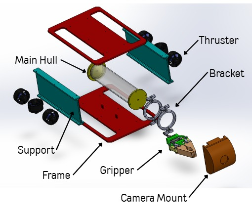
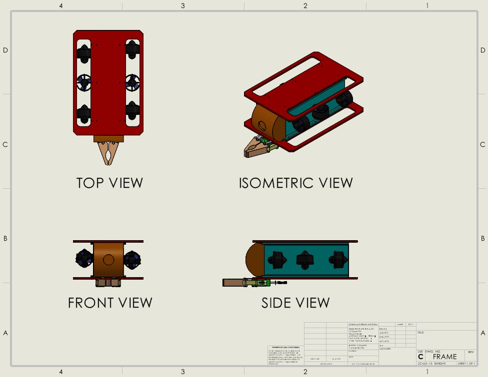
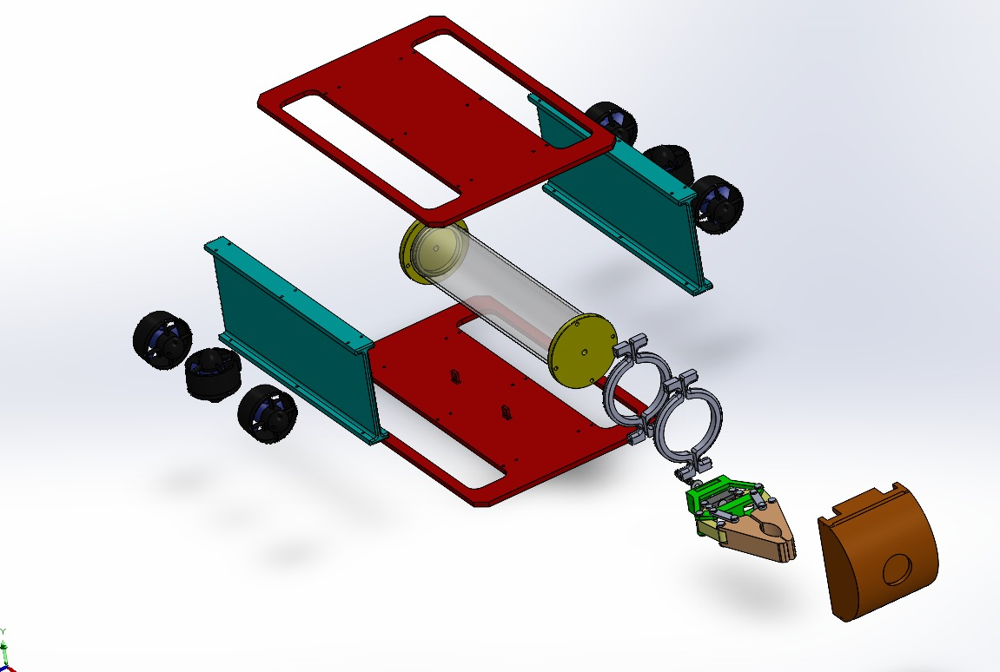
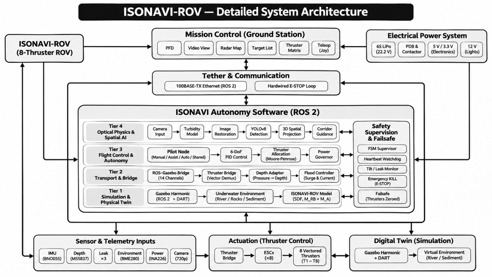
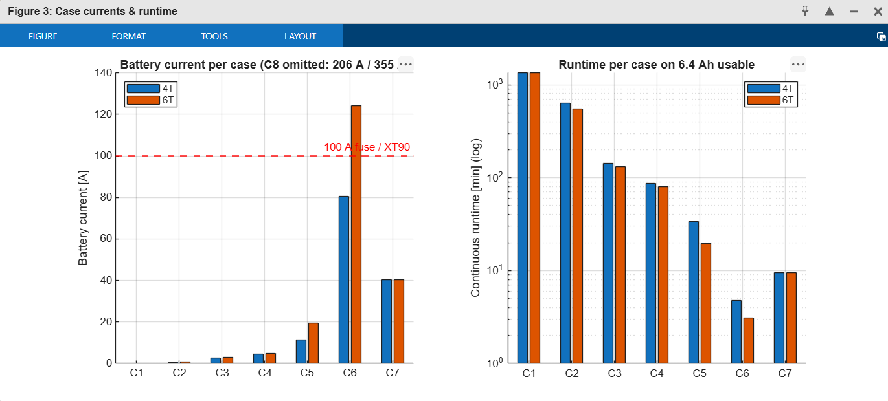
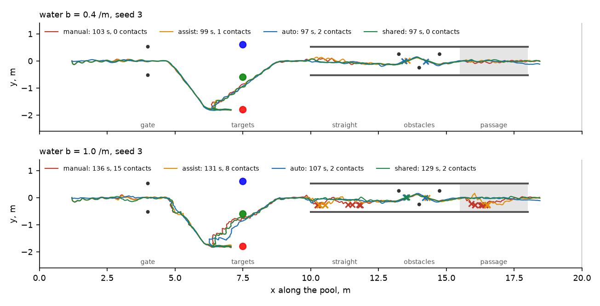
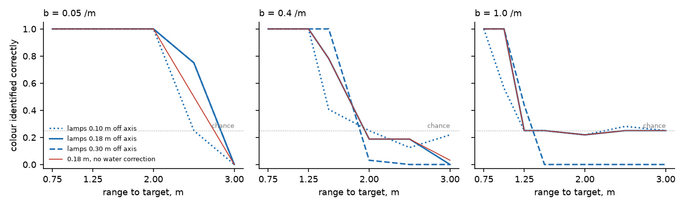
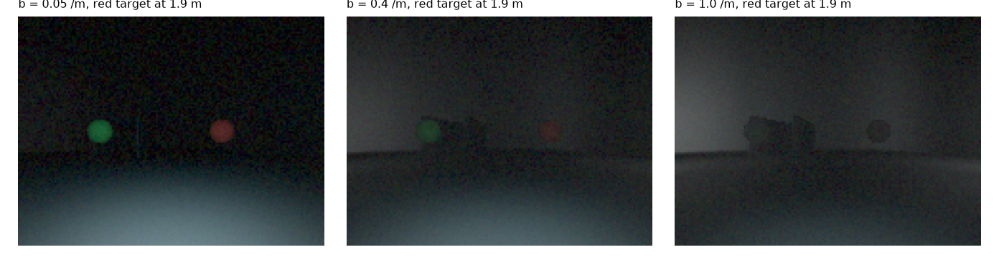
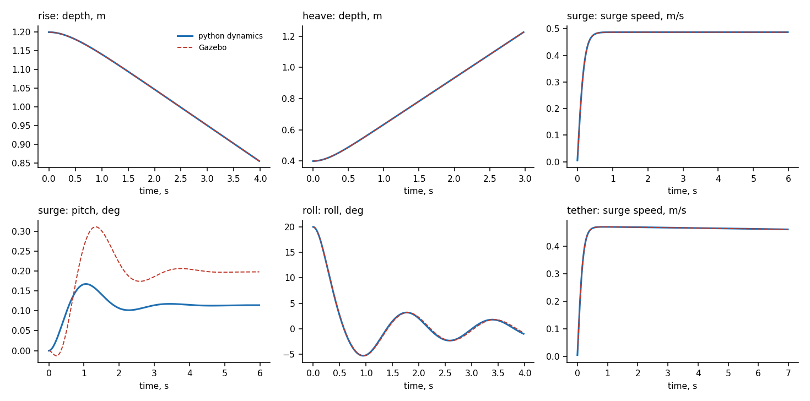

# isonavi-rov

**A pilot-assisted ROV with vision-based navigation for confined, low-visibility water.**
A person flies it over a tether; the vehicle holds depth, heading and attitude
on its own, and a camera that knows how far it can trust itself in the water at
hand shares the lateral control with the pilot.

<p align="center">
  
  
</p>

| | |
| --- | --- |
| Propulsion | 6 thrusters, 6 ESCs: 4 vectored horizontal for surge, sway and yaw, 2 vertical for heave |
| Structure | Open frame (two plates on side supports), one sealed acrylic hull, foam and ballast trim, front gripper |
| Sensing | Low-light camera with two lamps 0.18 m off axis, IMU, depth sensor, leak probes, power monitor |
| Link and power | Ethernet over a 50 m tether, hardwired emergency stop loop, power governor and a four layer stop chain |
| Software | ROS 2: pilot assist and shared modes, thrust allocation, safety supervisor, vision; a Gazebo digital twin |
| Targets | Under 20 kg (35 kg limit), inside 75 x 65 x 60 cm, at least 17.5 cm clear each side in a 1 m gate |
| Status | TRL 3: designed, sized and simulated; next is the build and water |

**Contents:**
[Problem](#problem) ·
[Vehicle](#vehicle) ·
[Architecture](#system-architecture) ·
[Working principle](#working-principle) ·
[Calculations](#preliminary-calculations) ·
[Electrical](#electrical-and-power) ·
[Simulation](#simulation-study) ·
[Digital twin](#gazebo-digital-twin) ·
[Cost](#estimated-cost) ·
[Plan](#development-plan) ·
[Team](#team) ·
[Repository](#repository-layout) ·
[Running it](#running-it)

## Problem

Pilots have to move through confined water and identify targets in low
visibility, with unstable motion and little visual feedback:

- low visibility and backscatter from the vehicle's own light hide targets and boundaries;
- constant depth and heading correction loads the pilot;
- a single camera view makes distance and clearance hard to judge;
- waterproofing, tether drag and power limits make operation fragile.

The vehicle has three tasks in a 20 x 10 m pool, 0.6 to 1.8 m deep, flown over
a tether of about 50 m:

| # | Task | What it asks |
| --- | --- | --- |
| 1 | Gate passage | Cross a 1 m wide submerged gate without touching it |
| 2 | Colour target | Find and touch the balloon of a given colour in low visibility |
| 3 | Maze | Fly all three sections of a walled maze with as few contacts as possible |

The vehicle must weigh no more than 35 kg. What follows from this is a safe,
compact, pilot-assisted ROV with stable control and vision that holds up in
murky water.

## Vehicle

The team's mechanical design is in [`cad/solidworks/`](cad/solidworks/)
(SolidWorks parts, assemblies, the frame drawing and turntable videos):

| Part | Design |
| --- | --- |
| Frame | Two cut plates, top and bottom, joined by side supports that carry the thrusters |
| Hull | One cast acrylic tube, 110 mm OD x 100 mm ID, about 480 mm long, with sealed end caps (`CAN-001` to `CAN-005`, face and sled O-rings) |
| Inside the hull | An electronics sled and a sled for the power pack (`ELEC-SLED`, `BATT-SLED`) on a spine |
| Thrusters | Six, on the side supports: 4 vectored horizontal at the corners, 2 vertical in the middle (`M080 Thruster`) |
| Gripper | Crank and slider jaw at the front, on a bracket clamped to the hull (`ASSem/Gripper`) |
| Camera | Camera mount at the front of the hull; lamps either side, 0.18 m off the lens axis |

<p align="center">
  
</p>

The python CAD in `cad/` (`rov_cad.py`, budget in `rov.py`) is the
parametric reference the simulation was built on: it solves mass, buoyancy and
trim, checks the envelope and the gate fit, and writes the Gazebo model.

## System architecture



The diagram is drawn on the eight thruster simulation reference; the build
runs six thrusters on six ESCs.

| Layer | What it does | Where |
| --- | --- | --- |
| Surface station | Joystick or keyboard, ground station (video, attitude, depth, thruster loads, supervisor state), emergency stop | `ros/isonavi_rov_ros/ground_station.py`, `keyboard_teleop.py` |
| Tether | Ethernet for ROS 2 and video; a hardwired stop loop on the spare pairs | `electrical/` (Section 12 of the power study) |
| Vision | Target finder and course estimators (gate, walls, target), calibrated per water clarity | `simulation/isonavi/vision.py`, `vision_node.py` |
| Flight control | Pilot node in manual, assist, auto or shared mode; depth, heading and attitude hold; thrust allocation about the CG | `simulation/isonavi/pilot.py`, `pilot_node.py` |
| Safety | Power governor, latching supervisor (kill, leak, 0.5 s link loss), actuator watchdog | `simulation/isonavi/safety.py`, `safety_node.py`, `hil/` |
| Actuation | ESC per thruster, driven over a serial link from the flight computer | `hil/esp32/`, `actuator_node.py` |
| Digital twin | Gazebo Harmonic model and worlds generated from the same budget, checked against the python dynamics | `ros/isonavi_rov_description/`, `ros/isonavi_rov_gazebo/` |

## Working principle

1. **The pilot flies; the vehicle holds.** Stick inputs set surge, sway and
   yaw rate and move the depth set point. The assist holds depth from the
   pressure sensor and heading and attitude from the IMU, so the pilot never
   trims by hand.
2. **The camera shares the lateral loop.** In shared mode the camera's
   corridor command and the pilot's are blended by inverse error variance:
   the estimator's measured error against the spread of the pilot's own
   reading of the corridor at that range and clarity. In clear water the pilot
   leads; in murky water the camera does.
3. **Thrust is allocated about the CG and capped.** The wrench is turned into
   per-thruster forces with the thrusters at their real positions, then a
   governor scales them to the power limit in one step, keeping the direction.
4. **Every layer can stop it alone.** Surface stop, external kill switch,
   supervisor (kill, leak or 0.5 s without a pilot packet) and the actuator's
   own watchdog. The vehicle floats positive, so zero thrust brings it up.

## Preliminary calculations

| Quantity | Relation | Value |
| --- | --- | --- |
| Water pressure at the 5 m design depth | p = rho g h | 49 kPa (17.7 kPa at 1.8 m) |
| Collapse pressure, 110/100 mm acrylic tube | Pcr = E / 4(1 - nu^2) (t / R)^3, E = 3 GPa, nu = 0.37 | 7.5 bar, about 15 x the load at 5 m |
| Hull buoyancy | F = rho g V, V = pi/4 D^2 L | 4.6 kgf; 3.6 kgf net of the 0.9 kg tube |
| Thrust to move at 0.5 m/s | F = 1/2 rho Cd A v^2, Cd 1.0, A 0.4 x 0.3 m | 15 N (about 1.5 kgf) |
| Gate clearance | (1000 - 400) / 2 for a 400 mm beam | 300 mm each side |

## Electrical and power

The team's power analysis is in [`electrical/`](electrical/): a 23 page
post-mortem of every one of the 28 electrical line items in every state (off,
idle, active, peak, fault), rolled up into rail budgets, battery current with
I^2R sag, losses, endurance and protection, for 4 and 6 thrusters, with a
MATLAB model that reproduces the tables
([`electrical/docs/ROV_Electrical_Power_PostMortem.pdf`](electrical/docs/ROV_Electrical_Power_PostMortem.pdf),
[`electrical/matlab/ROV_Power_Simulation.m`](electrical/matlab/ROV_Power_Simulation.m)).
It is written for an onboard 6S LiPo pack (22.2 V, 8 Ah); what it decides holds
for the six ESC build whichever way the bus is fed:

| Finding | Rule |
| --- | --- |
| A full pack is above the thrusters' 20 V rating; uncapped one would draw about 1083 W | Voltage compensated 400 W cap per thruster in firmware |
| Six thrusters at the cap ask for 124 A, past the 100 A fuse | 1700 W global budget, scaled across thrusters so the thrust direction is kept |
| Closing the contactor onto about 3 mF of ESC capacitance | 10 ohm pre-charge, 200 ms before ESC commands are accepted |
| Gigabit uses all four tether pairs | 100BASE-TX, stop loop on pairs 4/5 and 7/8 |
| Voltage alone misreads charge under 1.5 V of sag | Sag compensated cutoff and coulomb counting on the INA226 |
| Switches in the main current path would have to break 80 A DC | Arming switch and both stops in the contactor coil loop |

<p align="center">
  
</p>

The study's verification plan (pack resistance, hotel load, thruster curve,
cap, burst, pre-charge, stop timing, tether loop, thermal soak, heartbeat loss,
leak response) is Section 15 of the PDF.

## Simulation study

The simulation was built first, on the parametric reference vehicle in `cad/`:
the isonavi eight thruster vectored layout, 54 V down the tether from a 230 V
supply and no battery aboard. Its results set the pilot assist, the shared
mode, the lamp placement and the safety chain that the six thruster build
keeps; the numbers below are for that reference. The thruster layout and the
power path are parameters of the budget, so the study reruns on the build's
six thrusters once their bench curves are in.

Pilot-in-the-loop course runs on the reference layout, 20 seeds per cell, in
three water clarities (scattering coefficient b). Every run finished, passed
the gate clean and touched the right target. Contacts per run:

| Mode | b = 0.05 /m | b = 0.4 /m | b = 1.0 /m |
| --- | --- | --- | --- |
| manual | 0.50 +/- 0.59 | 0.65 +/- 0.85 | 8.55 +/- 5.28 |
| assist (depth, heading, attitude hold) | 0.15 +/- 0.36 | 0.45 +/- 0.59 | 5.85 +/- 5.53 |
| camera alone in the lateral loop | 2.50 +/- 0.67 | 2.80 +/- 0.81 | 2.90 +/- 0.83 |
| shared: pilot and camera blended by their errors | 0.20 +/- 0.40 | 0.40 +/- 0.58 | 0.45 +/- 0.86 |

On forty random layouts per cell, shared is level with the assist in turbid
water (+0.03 +/- 0.14 contacts a run, paired by layout) and 3.33 +/- 0.56
below it in murky water. Fly shared throughout; the weighting decides how much
to trust the camera from the water clarity (`docs/isonavi_rov_report.tex`).







Operator console of one run in murky water, shared mode, onboard camera
beside the track:
[`simulation/results/video/rov_course_shared.mp4`](simulation/results/video/rov_course_shared.mp4).

| Reference vehicle (simulated) | |
| --- | --- |
| Mass, envelope | 10.48 kg, 66 x 44 x 33 cm |
| Net buoyancy, BG, trim | +5.00 N, 45 mm, level |
| Surge force, all units / one lost | 84.9 N / 42.4 N |
| Speed, all units / one lost | 0.73 m/s / 0.50 m/s |
| Margin at 0.35 m/s with 8 m of tether trailing, one unit lost | 1.4 |
| Tether loop resistance | 0.344 ohm |
| Governed input, peak current, voltage aboard | 800 W, 16.6 A, 48.3 V |
| Surface supply, main fuse | 54 V 1000 W, 25 A |
| Link loss to zero thrust, rise in hold | 0.52 s, 0.87 m |
| Target colour identified, lamps as built | all to 2.0 m at b = 0.05, 78 % at 1.5 m at b = 0.4, all to 1.0 m at b = 1.0 |
| Itemised bill of materials, vehicle / with tether and surface station / total | Rs 74,722 / Rs 1,15,079 / Rs 1,38,027 |

### What the simulation decided

**In murky water the pilot's read fails; in clear water the camera's does.**
Depth and heading hold cut contacts in clear and turbid water, but at
b = 1.0 /m the pilot's read of the corridor degrades with the two way
attenuation of the vehicle's own light, and contacts rise to 8.55 +/- 5.28,
most of them with the maze walls. The camera alone holds two to three
contacts at every clarity, because its error comes from the estimator, not the
water; they are at the first two slalom posts, where the gap leaves
142 mm a side and the wall estimate, disturbed by the posts, errs by
92 mm RMS.

**So blend them by their errors.** The shared mode weights the camera's
lateral command against the pilot's by inverse error variance: the
estimator's held-out error for that section and range against the spread of
the pilot's read at that range and clarity. It is no worse than the assist
where the pilot can see and removes the wall contacts where the pilot cannot.

**A lone column is not a gate post.** Close to the gate one post leaves the
frame, and the gate fit took an object far beyond it for the missing post and
steered towards the post it could no longer see. The fit now needs both posts
in frame, each with its own column, or gives no measurement; the gate is then
passed clean in every run of every mode.

**Colour goes before the target does.** Red is absorbed several times faster
than blue, and the lamps light the water in front of the lens. Undoing the
water using range from the target's known size beats a fixed threshold at the
edge of the envelope (0.75 against 0.50 at 2.5 m in clear water), but the
hard limit is signal against backscatter. The rule that follows: close to
1 m before committing to a colour; every run touched the right target.

**Lamps belong well off the lens axis.** At b = 0.4 /m and 1.5 m, lamps
0.10 m off axis identify 41 % of targets; at 0.18 m, as built, 78 %. The
44 cm beam has room for that.

**The tether is a third of the load.** At 0.35 m/s, 8 m of trailing tether
adds 9.4 N to the frame's 21.9 N. Sized against that with one unit lost, a
25 N thruster leaves almost no margin, which is what set the bench target at
30 N per unit.

**Horizontal thrusters below the CG pitch the vehicle.** On the reference
the horizontals sit 53 mm below the CG. At the full
surge envelope that is 4.5 N m of pitch against a righting moment that peaks at
m g BG; uncorrected it would hold the vehicle about 76 degrees nose up. The
allocation takes its moments about the CG with the thrusters at their real
heights, so surge brings the verticals in to hold pitch. The Gazebo model,
which places the thrusters where the CAD has them, is what showed it.

**All thrusters at once is not a design point.** On the reference, uncapped
they draw 1079 W, which would need a 40 A fuse. A governor in the allocator
caps input at 800 W and is exact in one step, because propeller power is
homogeneous of degree 3/2 in thrust; all together they still make 24.3 N each.
The power study reaches the same rule for the six thruster build: a cap per
thruster and a global budget.

**Thrusters made in house.** The reference's thrusters (printed duct and
propeller on a potted outrunner), end caps, frame, buoyancy, lamp housings,
kill switch, thermal bridge, tether floats and thrust rig are 13 of 35 lines.
The motor is matched to the propeller rather than picked by habit
(`cad/thruster.py`): a 76 mm ducted propeller makes 30 N at about 2850 rpm, so
a 1000 KV winding would carry 27.4 A of phase current, past 80 % of its 30 A
controller; the 750 KV winding carries 20.5 A and draws 114 W at the bench
point.

### Safety chain, end to end

Four layers, each able to stop the thrusters alone: a fused surface supply
with an emergency stop; an external magnet kill switch that opens the thruster
rail; the supervisor, which zeroes thrust on a kill, a leak, or 0.5 s without
a pilot packet; and the ESP32, which drops every channel to neutral if the
flight computer goes quiet, which its firmware already does. The ROS 2 chain
was run end to end under Jazzy: with the pilot link live the actuator node
emits the expected pulse widths, and when the joystick stops it reports
`HOLD: pilot link lost` and every channel goes to 1500 us. The pilot node
runs the shared blend with the simulation's own functions, and the chain test
checks its sway command against them.

## Gazebo digital twin

The vehicle also flies in Gazebo Harmonic under ROS 2 Jazzy, on the same
nodes, in a pool world built from the course arena (any random layout with
`make_world.py --layout k`). Neither is typed by hand: the model's mass,
inertia, added mass, damping, thruster stations and displaced volume come
from the solved budget, its meshes from the CAD, and the tether drag is the
course runs' own, applied every physics step. Flown open loop with the same
thruster forces, it agrees with the python dynamics to 0.08 mm in a free rise,
0.07 mm and 0.34 mm/s in surge, 0.09 mm with the tether, and 0.18 degrees of
roll over a 25 degree swing. Gazebo renders the camera without water, so
the vision results stay with the camera model; the Gazebo camera is for the
plumbing and the pilot's video. It renders at 640 x 480 and the vision node
averages it back to the calibrated 160 x 120; without a GPU that is about
2.5 frames a second rather than 10.



For piloting by hand there is a keyboard teleop and a ground station, two
river worlds (`indian_river`, and the heavier `large_river`, both hand built
scenery) and a flood current set through the hydrodynamics. The operator video
adds simulated mud and dehazes it. It finds targets further out than the raw
frame but breaks the range estimate, so the flight vision stays on the raw
camera.

A recorded piloting session in the large river world, keyboard teleop with
the operator video beside it, is in
[`docs/media/gazebo_river_session.webm`](docs/media/gazebo_river_session.webm)
(5 min; recorded on an earlier, hand written vehicle model before the
generated one replaced it).

## Estimated cost

| Mechanical | Rs | Electrical and embedded | Rs |
| --- | --- | --- | --- |
| Hull and frame: tube, end caps, seals, glands, viewport, frame stock, fasteners, printed mounts | 23,000 | Thruster drive: 6 BLDC motors, 6 ESCs | 22,000 |
| Propulsion hardware: housings and shrouds, propellers, shafts, bearings, seals | 12,000 | Power and tether: 50 m tether, surface 48 V supply, onboard DC-DC converters | 18,000 |
| Buoyancy and tether handling: foam, ballast, tether floats, strain relief, reel | 7,000 | Compute and network: onboard computer, control board, network and media converter | 14,000 |
| Fabrication: machining and cutting, print material, welding and finishing | 9,000 | Vision and sensors: low-light camera, LED lamps, depth sensor, IMU and compass | 13,000 |
| Test and validation: thruster bench, pool hire (4 sessions), weighing scale | 17,500 | Safety, wiring and station: kill switch, fuses, contactor, leak sensors, connectors, PCBs, pilot controller | 15,500 |
| Contingency | 6,500 | Contingency | 7,500 |
| **Mechanical** | **75,000** | **Electrical and embedded** | **90,000** |

**Whole vehicle: Rs 1,65,000.** The itemised bill of materials for the
simulated reference, with the basis of every price, is generated by
`cad/rov_bom.py`.

## Development plan

| Days | Mechanical | Electrical and embedded |
| --- | --- | --- |
| 1 to 6 | Fix the specs: weight, size and gate fit limits, thruster layout | Fix the specs: voltage, current, power budget, component list |
| 7 to 18 | Design in CAD; buoyancy, weight and thrust | Architecture: block diagram, power distribution, Ethernet/UDP link |
| 19 to 27 | Source and cut: tube, seals, foam; machine frame and end caps | Design PCBs: power, interface and leak detection boards |
| 28 to 38 | Build thrusters; thrust curves on the bench | Source components (to day 37) |
| 39 to 46 | Seal the hull; dunk test before electronics go in | Fabricate and bench test PCBs (from day 38) |
| 47 to 55 | Assemble: hull, thrusters, foam, camera and lamp rig on the frame | Integrate power, propulsion, sensors, camera, lighting and stop |
| 56 to 60 | Trim to neutral in the tank; check weight and size | System testing: power load, UDP/RTSP link, sensors |
| 61 to 70 | Pool trials: gate runs and a mock course; film the 1 minute video | Pool validation: performance, power draw, thermal, leak detection |
| 71 to 75 | Freeze, build spares and a repair kit, pack | Cable management, waterproofing, documentation, final lock |

| Technology readiness | Now | Basis |
| --- | --- | --- |
| Control software and safety logic | TRL 3 | Depth, heading and attitude hold, allocation and failsafes proven in simulation and on a bench loop |
| Camera-based navigation | TRL 3 | Gate, wall and colour target detection on simulated pool scenes in clear, turbid and murky water |
| Structure and hydrodynamics | TRL 3 | CAD complete; mass, buoyancy, thrust and power budgets closed; Gazebo model checked against the dynamics |
| Electrical and power | TRL 3 | Power path, fusing and governor sized by calculation; power study with a MATLAB model |
| **Target** | **TRL 6** | Full prototype demonstrated in the operating environment |

## Team

| Name | Role | Owns |
| --- | --- | --- |
| Chaitanya Karole | Mechanical lead | Frame, acrylic hull and thruster mounts from CAD to fabrication; mass, buoyancy and trim; sealing, vacuum and dunk tests |
| Rohit Wakade | Electrical and power lead | Power path, fusing and governor; ESC wiring, thruster interface and lamps; kill switch, leak detection and link loss stop |
| Hasan Rupawalla | Research and vision lead | Camera and lighting across water clarities; gate, wall and colour target detection; test plans, pool data and the report |
| Aadi Joshi | Software and controls lead | ROS 2 stack: holds and thrust allocation; shared pilot and camera mode, operator console; simulation, Gazebo and the bench |

Also contributed: the Gazebo piloting tools (keyboard teleop, ground station,
river worlds) by `prjwaal`; the tow point, thermal bridge and supply rework by
`AnvayGhare22`; and work by `ManavSharma2707`.

## Repository layout

| Path | Contents |
| --- | --- |
| [`cad/solidworks/`](cad/solidworks/) | Team mechanical design: SolidWorks parts, assemblies (frame, hull, sleds, thruster, gripper), frame drawing, renders and turntable videos |
| [`cad/`](cad/) | Parametric reference: `rov.py` mass, buoyancy and trim, envelope, thrust with a unit lost, tether and fuse; `rov_cad.py` CadQuery assembly; `thruster.py` motor and propeller match; `rov_bom.py` bill of materials |
| [`electrical/`](electrical/) | Team power study: report (PDF), MATLAB model and its figures |
| [`simulation/isonavi/`](simulation/isonavi/) | Pool arena (`pool.py`), camera image formation under the vehicle's lamps (`optics.py`), target finder and course estimators (`vision.py`), operator model, assist and shared blend (`pilot.py`), governor and supervisor (`safety.py`), 6-DOF dynamics (`dynamics.py`) |
| [`simulation/eval/`](simulation/eval/) | Trials, vision calibration and evaluation, figures, video, report metrics |
| [`ros/`](ros/) | ROS 2 packages: vehicle nodes (`isonavi_rov_ros`), generated Gazebo model (`isonavi_rov_description`), worlds, bridge and launch (`isonavi_rov_gazebo`); `test_chain.sh` and `test_sim.sh` |
| [`hil/`](hil/) | Flight computer and ESP32 actuator interface, validated on hardware for isonavi; the ROV bench over the same link |
| [`docs/`](docs/) | Technical report `isonavi_rov_report.tex` (every number from `simulation/eval/make_rov_metrics.py`), the README check, architecture diagram and the Gazebo session video in `docs/media/` |
| [`cv/`](cv/) | Detector and classifier notebooks and results from isonavi |

The project grew out of isonavi, an autonomous river survey vehicle. The
survey stack (`acoustics.py`, `scene.py`, `mapping.py`, the learned sonar
perception) and the isonavi-1 documents in `docs/` are unchanged and still
run; the ROV takes over its 6-DOF dynamics, ray casting, actuator path and
solved budget:

| isonavi-1 | isonavi-rov | Reason |
| --- | --- | --- |
| Autonomous survey | Piloted over a 50 m tether, with assist and a shared camera mode | A person flies it; the vehicle holds depth and attitude and adds the camera where it sees better than the pilot |
| 28 kg, 1074 mm faired hull, fins | Compact open frame, one acrylic hull | No current to fight; a small box clears a 1 m corridor |
| 50 m pressure rating, ring frames | One acrylic housing, 5 m design depth | Pool depth is under 2 m |
| Forward-looking sonar and DVL | Camera and two lamps, IMU, depth | The targets are identified by colour, in the dark |
| 1.5 kWh battery aboard | Reference: 54 V down the tether from a 230 V supply, no battery | Removes the battery and its leak risk from the vehicle |
| Mission state machine | Pilot assist, power governor, safety supervisor, ROS 2 | The vehicle must stop safely on a kill, a leak or a lost link |

## Running it

```bash
cd cad
python rov.py                                   # vehicle budget, envelope, tether, fuse
python thruster.py                              # motor and propeller match
python rov_bom.py                               # bill of materials

cd ../simulation
PYTHONPATH=. python tests/smoke_rov.py          # arena, camera, vision, pilot, safety
PYTHONPATH=. python eval/vision_calibrate.py    # course estimator fit and held-out error
PYTHONPATH=. python eval/run_trials.py          # course runs by mode and water clarity
PYTHONPATH=. python eval/vision_eval.py         # identification by range, clarity, lamp placement
PYTHONPATH=. python eval/rov_figures.py         # figures
PYTHONPATH=. python eval/make_rov_video.py      # operator console video, shared mode in murky water

cd ..
python hil/test_rov_loopback.py                 # vehicle software over the link, link loss, kill
bash docs/build.sh                              # reports, and the check that README numbers match
bash ros/test_chain.sh                          # ROS 2 build and chain test, under Jazzy
bash ros/test_sim.sh                            # Gazebo model check and the nodes flying it, closed loop
ros2 launch isonavi_rov_gazebo sim.launch.py headless:=false gcs:=true   # the pool, with the GUI and the ground station
ros2 launch isonavi_rov_gazebo sim.launch.py headless:=false world:=indian_river camera:=true
ros2 run isonavi_rov_ros teleop                 # keyboard pilot, if the ground station is not driving
ros2 run isonavi_rov_gazebo flood_ctl start     # flood current, stop to end it
```

The power model runs in MATLAB R2018b or later, or MATLAB Online, with no
toolboxes: `cd electrical/matlab` then `ROV_Power_Simulation`.

`make_model.py` needs CadQuery for the meshes; the generated model and world
are committed, so only a change to the budget, the CAD or the arena calls for
running them again.

## Status

Designed, sized and simulated (TRL 3). The team CAD and the power study define
the six thruster build; the simulation, the Gazebo twin and the ROS 2 chain
were verified on the parametric reference and carry over node for node. The
actuator interface and the flight computer pattern come from isonavi, where
they were validated on hardware. Next is water: thruster bench curves, a hull
vacuum and dunk test, trim in a tank, the study rerun on six thrusters with the
measured curves, and pilot hours on a mock course.
