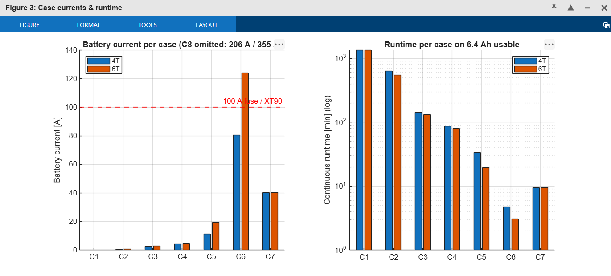
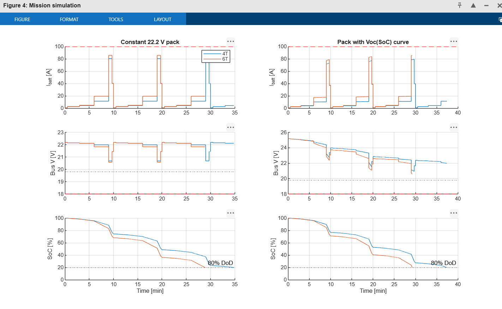
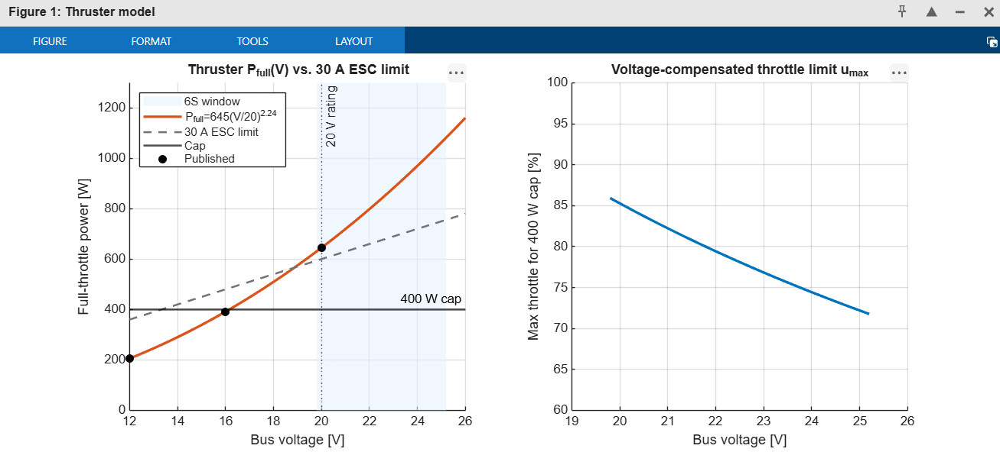
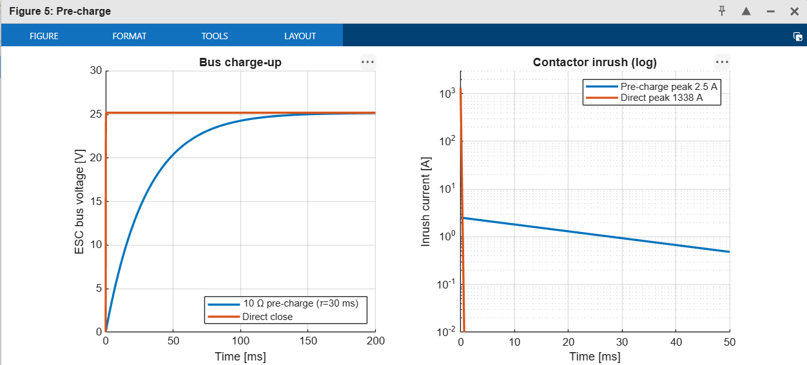
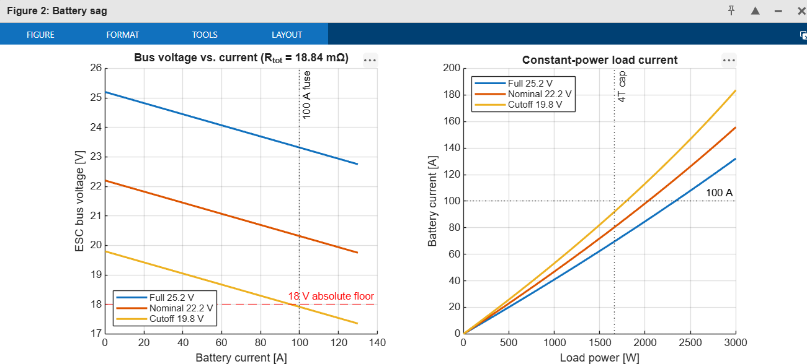

# ROV Electrical Power Post-Mortem

Component-level voltage, current and power analysis of a 6S LiPo-powered ROV (4- and 6-thruster
configurations), with a MATLAB simulation that reproduces and extends the numbers in the report.

- **Report:** [`docs/ROV_Electrical_Power_PostMortem.pdf`](docs/ROV_Electrical_Power_PostMortem.pdf) (Rev 1.0, 10 Nov 2026)
- **Simulation:** [`matlab/ROV_Power_Simulation.m`](matlab/ROV_Power_Simulation.m)
- **Graphs:** [`results/figures/`](results/figures/)

## Repository layout

```
rov-electrical-power-postmortem/
├── README.md
├── .gitignore
├── docs/
│   └── ROV_Electrical_Power_PostMortem.pdf
├── matlab/
│   └── ROV_Power_Simulation.m
└── results/
    └── figures/            # PNG exports of every simulation figure
```

## Running the simulation

Needs MATLAB R2018b+ (or MATLAB Online); no toolboxes.

```matlab
cd matlab
ROV_Power_Simulation
```

The script prints the C1–C8 case tables, the mixed-mission endurance and the time-domain results,
opens five figures, then exports them to `results/figures/*.png` and bundles them into
`results/ROV_graphs.zip` (git-ignored). On MATLAB Online, right-click the zip in the Current Folder
panel and choose **Download**.

All inputs (battery, thruster fit, converter efficiencies, case definitions, pre-charge) are in
`rov_params()` at the bottom of the script. Change a value and rerun to see its effect.

## How the simulation maps to the report

| Report section | Simulation | Figure |
|---|---|---|
| §4 Battery sag, `V = Voc − I·R` | `solve_current()` solves `R·I² − Voc·I + P = 0` | [Fig 2](results/figures/02_Battery_sag.png) |
| §7 Thruster model `P = 645·(V/20)^2.24`, `P(u) = Pmax·u³` | `thr_pfull()`, 400 W cap, `u_max` limit | [Fig 1](results/figures/01_Thruster_model.png) |
| §8 Cases C1–C8, 4T vs 6T | `case_eval()` | [Fig 3](results/figures/03_Case_currents_runtime.png) |
| §9 Mixed mission and endurance | static weighted average + time-domain run | [Fig 4](results/figures/04_Mission_simulation.png) |
| §11 Contactor pre-charge | RC transient, 10 Ω vs direct close | [Fig 5](results/figures/05_Pre_charge.png) |
| §13 Firmware power manager | 400 W cap, 1700 W budget, derate, cutoff, run at each time step | [Fig 4](results/figures/04_Mission_simulation.png) |

## Validation against the report (nominal 22.2 V)

The simulation's static case results match the report's Section 8 tables.

| Case | 4T power / current | 6T power / current |
|---|---|---|
| C2 armed idle | 13 W / 0.6 A | 16 W / 0.7 A |
| C4 inspection | 98 W / 4.4 A | 107 W / 4.8 A |
| C5 cruise | 252 W / 11.4 A | 427 W / 19.5 A |
| C6 all at cap | 1663 W / 80.4 A | 2466 W / 124.1 A (> 100 A fuse) |
| C8 fault, cap bypassed (25.2 V) | ≈ 4.4 kW / 206 A | ≈ 6.6 kW / 354 A |

With the 1700 W global budget the 6T C6 case drops to ≈ 86 A, below the 100 A fuse.



### Mission endurance: why the time-domain run differs from the report

The report's 31 min (4T) and 21 min (6T) come from a weighted-average current over the whole
mission. The time-domain run steps through a repeating 10-minute mission instead. It also shows:

- **Cycle phase:** the run ends part-way through a cycle, in a low-current segment, so the 4T run
  lasts a few minutes longer than the pure average (≈ 35 min on a fixed 22.2 V pack).
- **6T budget:** the 6T run applies the 1700 W budget to C6, as the firmware would; the report's
  average used the un-budgeted 124 A.
- **Pack voltage:** the open-circuit voltage curve is a typical LiPo curve I assumed. The report
  gives none. The curve gives the pack a higher average voltage, so the currents are lower.



## Key findings reproduced

- **F1 – thruster over-voltage:** a full 6S pack (25.2 V) exceeds the 20 V thruster rating, so an
  uncapped thruster would draw ≈ 1083 W. A voltage-compensated 400 W firmware cap (≈ 72 % throttle at
  full charge) is mandatory.

  

- **F2 – bus over-current with 6 thrusters:** 124 A against a 100 A fuse and XT90. The 1700 W budget
  brings it to ≈ 86 A at 22.2 V.
- **F5 – contactor inrush:** a direct close onto ≈ 3.0 mF gives a theoretical 1338 A spike. A 10 Ω
  pre-charge (τ ≈ 30 ms) limits it to 2.5 A.

  

- **Battery sag:** at cutoff with all four thrusters at cap the bus falls to ≈ 18 V, so the
  low-voltage cutoff must use a sag-compensated estimate.

  

## Assumptions and limits

The model inherits the report's assumptions: a T200-class thruster fit, 2.5 mΩ per cell, 3.84 mΩ
of distribution resistance, and ESC idle current and capacitance from typical values. Report
Section 15 lists the bench tests that replace these with measurements. The pack open-circuit curve
and the 10-minute mission order are additions in this simulation.
